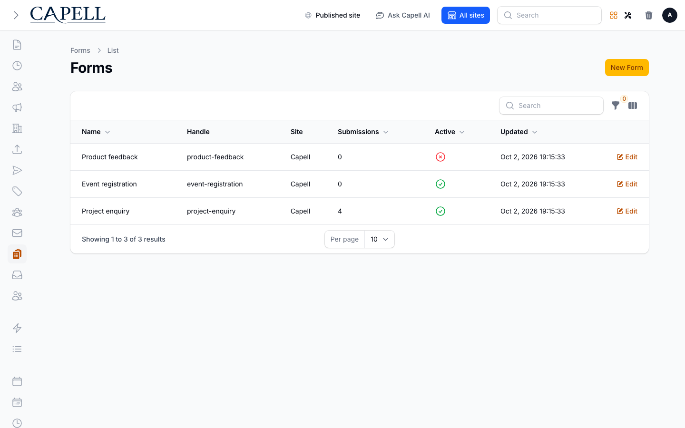
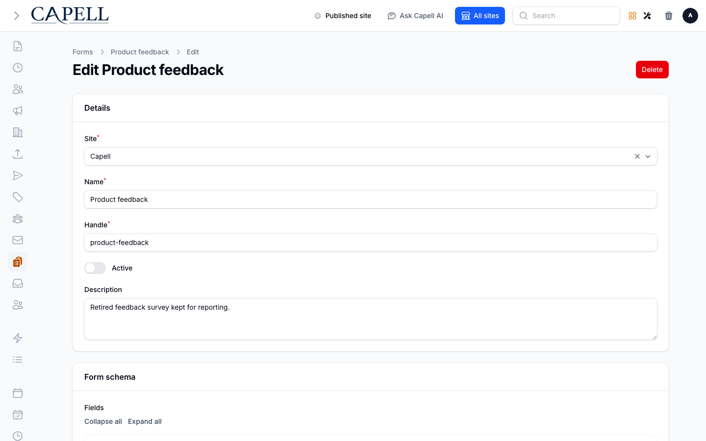

# Form Builder

<!-- prettier-ignore-start -->

## What It Does

Form Builder adds site-scoped form schemas, conditional and multi-step fields, calculations, spam checks, optional payment handoff, and encrypted submission records.

- **Price and availability:** Check current availability and price on the [Capell Marketplace listing](https://capell.app/extensions/form-builder).
- **Licence:** Check the licence terms on the [Capell Marketplace listing](https://capell.app/extensions/form-builder).
- **Requires:** `PHP ^8.4`, `capell-app/admin ^1.0.66`, `capell-app/core ^1.0.75`, `capell-app/frontend ^1.0`.
- **Install:** `composer require capell-app/form-builder`.

Editors build forms and triage submissions in the admin, while visitors complete the published form through a Livewire frontend component.

## Who It Is For

**For developers:** Typed field data and Actions handle visibility, validation, calculations, spam scoring, rate limits, and persistence, with a contract for replacing the spam provider.

**For teams:** Teams can publish structured forms, receive notifications, review or reply to submissions, and apply retention or legal-hold rules from one workflow.

## Quick Start

1. Install the package: `composer require capell-app/form-builder`.
2. For Editors: Permission to edit forms on an authorised site, a compatible page element or developer integration, and submission-view permission to check the inbox.
3. Open `/admin/form-builder/forms`. Save an active enquiry form and follow Put this form on a page. Preview same-site placement, publish explicitly and send a labelled public test enquiry.
4. Check the result: With Store submissions enabled, the enquiry appears in View submissions with the expected fields. Next: Check notifications and remove or archive the test enquiry according to your retention policy.

## Configure

- **Configuration files:** `config/capell-form-builder.php`.
- **Commands:** `php artisan capell:form-builder:export-submissions`, `php artisan capell:form-builder:prune`.

## Limits And Pitfalls

- Install the required Capell packages at the versions in `composer.json`: `capell-app/admin ^1.0.66`, `capell-app/core ^1.0.75`, `capell-app/frontend ^1.0`.
- Run migrations before opening package resources or public routes.
- Review middleware, throttling, signatures, and public-output safety in `routes/payments.php` before exposing routes.
- Keep the host Laravel scheduler running so package-registered schedules can execute: `capell:form-builder:prune (daily; package registered)`.
- Keep public Blade and cached HTML free of authoring markers, model IDs, permissions, signed editor URLs, and lazy database queries.
- Custom write integrations must preserve invalidation for `form-builder` cache tags.

## Screens And Workflow

- FormBuilder admin index (admin).
- Create/edit form schema screen (admin).
- Submissions index (admin).
- Frontend form output (frontend).
- Submission detail view (admin).
- FormBuilder admin index with admin sidebar menu open (admin).

## Install Impact

- Required packages: `capell-app/admin`, `capell-app/core`, `capell-app/frontend`.
- Admin navigation: declares `admin-resource: FormResourceContribution`, `admin-resource: SubmissionResourceContribution`; each Filament page or resource controls its own navigation visibility.
- Admin/editor extensions: none declared.
- Permissions: `ViewAny:Form`, `View:Form`, `Create:Form`, `Update:Form`, `Delete:Form`, `DeleteAny:Form`, `Restore:Form`, `RestoreAny:Form`, `ForceDelete:Form`, `ForceDeleteAny:Form`, `Reorder:Form`, `ViewAny:Submission`, `View:Submission`, `Reply:Submission`, `Update:Submission`; access also governed by package policies: `FormPolicy`, `SubmissionPolicy`.
- Public routes: loads `routes/payments.php`; registers `FormBuilderPaymentRoutesContribution`.
- Database changes: package migrations are declared.
- Config: `config/capell-form-builder.php`.
- Settings: no package settings declared.
- Queues or schedules: scheduled commands `capell:form-builder:prune (daily; package registered)`; queue jobs `DispatchSubmissionWebhookJob`.
- Cache tags: `form-builder`.
- Commands: `capell:form-builder:export-submissions`, `capell:form-builder:prune`.

## Troubleshooting

| Symptom | Likely cause | Check | Fix |
| --- | --- | --- | --- |
| Package surface is missing after install | Provider or manifest is not loaded | Confirm `capell.json`, package `composer.json`, and provider registration | Reinstall the package, refresh Composer autoload, and clear host caches |
| Admin screen or command fails on missing table | Package migrations have not run | Check the tables listed in `Data Model` | Run host migrations and rerun the focused package test |
| Route returns unexpected output | Route cache, middleware, or signed URL setup does not match the package route file | Check the route files listed in `Technical Shape` | Clear route cache and verify middleware before exposing public routes |
| Background work does not run | Queue worker or declared schedule is not active | Check the jobs and scheduled commands listed in `Technical Shape` | Start the queue worker or host scheduler, then run the focused command or package test |
| Public output leaks unexpected state | Render data, cache variation, or authoring boundary has regressed | Check public Blade, cache tags, and public-output safety tests | Move data loading out of Blade and rerun the package public-output tests |

## Upgrading

No manual steps between minor versions.

Read [CHANGELOG.md](CHANGELOG.md) before upgrading.

## Next Steps

- [Package docs](docs/README.md)
- [Overview](docs/overview.md)
- [Worked extension examples](docs/extension-contracts.md)
- [Worked action walkthroughs](docs/extension-examples.md)
- [Admin guide](docs/admin-guide.md)
- Configuration files: [`config/capell-form-builder.php`](config/capell-form-builder.php).
- [Troubleshooting](#troubleshooting)
- [Developer reference](docs/reference.md)
- [Marketplace assets](docs/assets/marketplace/)
- [Capell content language plan](../../docs/CONTENT_LANGUAGE_PLAN.md)
- [Capell documentation design system](../../docs/DESIGN_SYSTEM.md)
- [Capell and package ERD notes](../../docs/erd/capell-and-package-erds.md)
- Related packages: [Payments](../payments/README.md).

<!-- prettier-ignore-end -->
