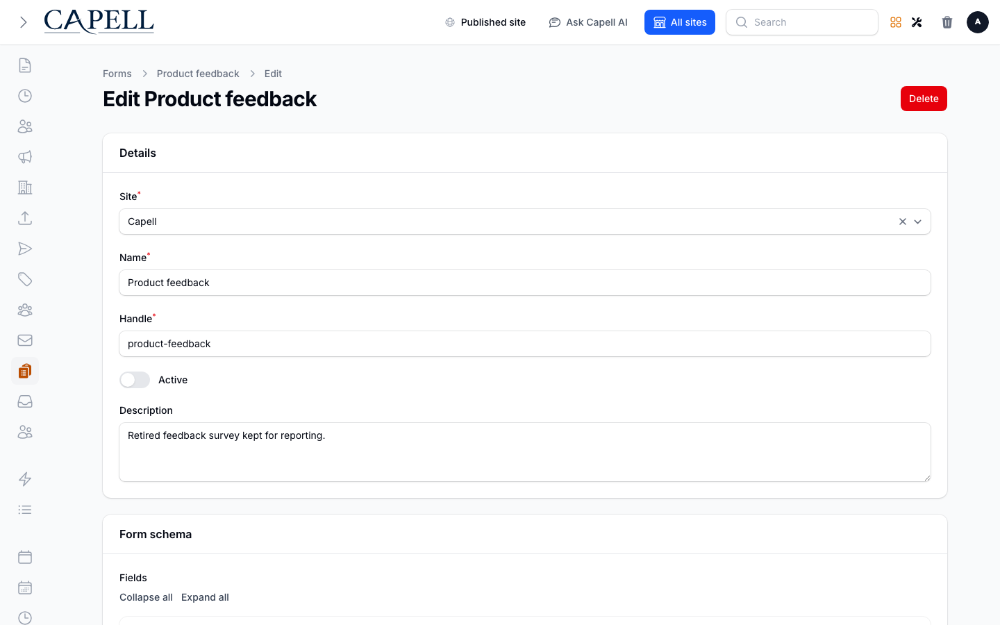
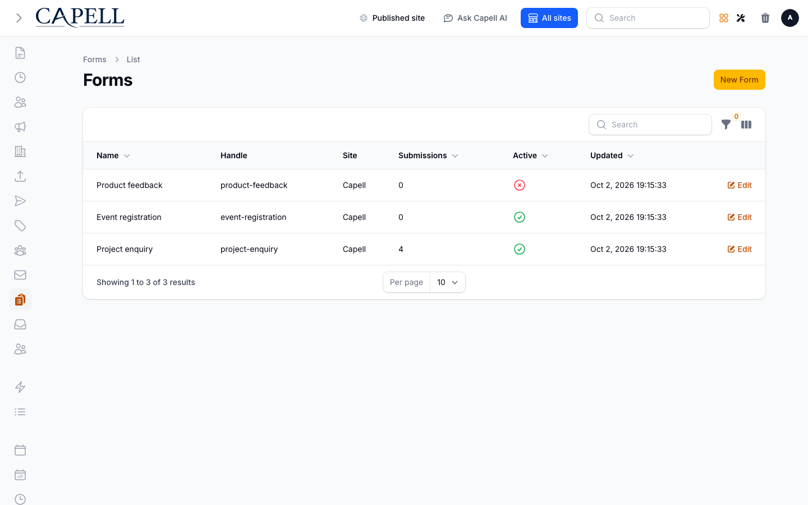
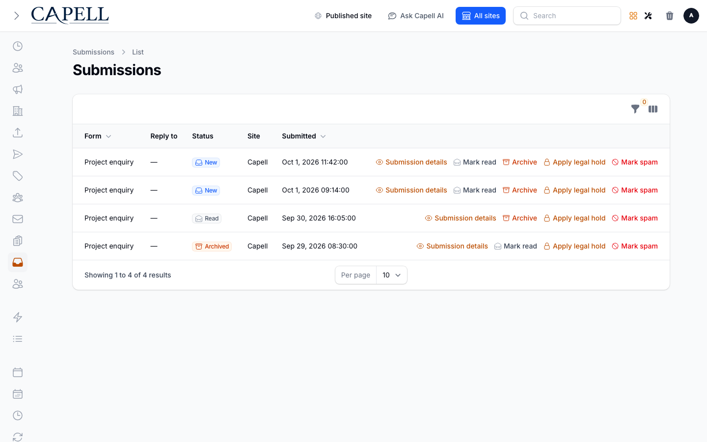
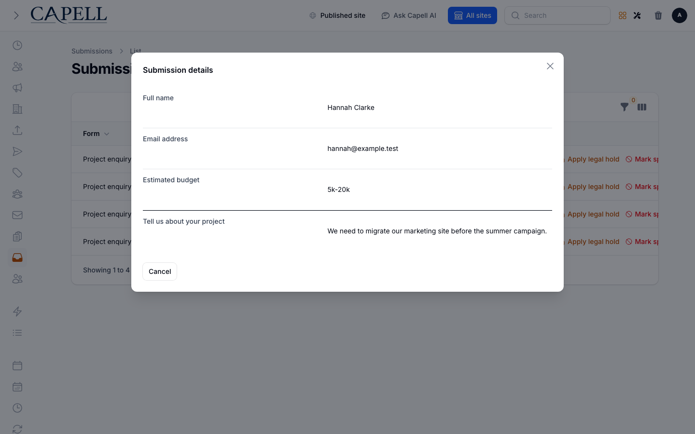

# Using Form Builder

This guide is for editors who build forms and owners deciding where submissions go. Every step uses the labels you see on screen.

## Using Form Builder (editor how-to)

### How to build a form

1. Open **Marketing > Forms** and create a new form.
2. Choose the **Site**, give the form a clear **Name**, and enter a unique **Key** for the frontend component to resolve.
3. Add fields by choosing each one's **Key**, **Label**, and **Type** (text, email, select, and so on). Reorder the schema entries when their public order needs to change.
4. Mark the fields people must complete as required.
5. Set validation and form settings such as **Store submissions**, **Notification email**, autoresponder, success message or redirect, and webhook URL as needed. Leave **Active** on only when it is ready for visitors.
6. Save the form. The editor opens **Put this form on a page** with placement and test instructions. You can reopen that action from the saved form. Saving does not publish a page.

### How to review your forms

1. Open **Marketing > Forms**.
2. The list shows each form's **Name**, **Key**, site, submission count, and whether it is **Active**.
3. Open any form to edit it, or create a new one.

### How to embed a form on a page

1. Open the saved form's **Put this form on a page** action. Keep **Store submissions** on if you need an inbox record of the test.
2. If your page editor provides the Form element, choose this form's **Key** there on a page on the same site. Otherwise give the developer the key and site shown in the action; they must wire the supported public form component into the page or layout first.
3. Save the page as a draft and preview it. Only an **active**, same-site form renders; inactive, missing and foreign-site keys show the unavailable fallback. Publish explicitly when ready.
4. Open the public page and send a clearly labelled test enquiry. Use **View submissions** to inspect the stored fields and check any configured notification inbox. This link requires submission-view permission; ask an authorised colleague to check if you cannot view submissions.

### How to view submissions

1. Open **Marketing > Form submissions**.
2. Triage entries that are **New**, **Read**, **Spam**, or **Archived**.

3. Choose **Submission details** on an entry to inspect the stored submitted fields.
4. Use **Mark read**, **Mark spam**, **Archive**, or the legal-hold action as appropriate. **Reply** is available when the system can resolve a reply email address from that submission.

### How to get notified

1. In the form's settings, set a **Notification email**.
2. Save and submit a test through the public form. Check the recipient inbox and spam folder; notifications are sent when the form receives a submission.

### How to choose the visitor's email address

1. Add an **Email** field for the visitor. Give every field a unique **Key** across all steps and conditions.
2. In settings, choose **Visitor email field**. The options show only Email fields, with their labels and keys. For example, choose the visitor's address when the form also asks for a colleague's email.
3. Save and submit a test with different addresses in each Email field. Check that **Reply**, the notification's Reply-To and any configured autoresponder use the chosen visitor address. **Notification email** remains the inbox that receives submission notifications.

Leave **Visitor email field** empty for automatic selection: the first valid submitted Email address in form order. Existing forms keep this behaviour until you select a field. If the selected field is removed, its key changes, its type changes or its answer is missing or invalid, selection falls back to the first valid Email field. Without any valid Email address, replies are unavailable and no autoresponder is sent. Spam submissions are never used for replies or autoresponders.

Existing submissions keep their original answer keys and use the form's current settings and Email fields when resolving a reply address. Check the selection after changing fields or keys. Emails already queued retain the recipient and Reply-To chosen when they were queued.

## Rolling out Form Builder (for owners)

### Turn on first

- One clear form with notifications. Build a simple contact or enquiry form and confirm submissions and notifications work before adding more.

### Add when needed

| Need                               | Enable                            |
| ---------------------------------- | --------------------------------- |
| Stop junk submissions              | Spam protection and **Mark spam** |
| Route enquiries to the right inbox | A **Notification email** per form |

### Don't enable yet

- Don't add lots of fields. Short forms get more submissions. Add fields only when you truly need the data.

### Who does what

| Role       | First useful screen                                                 |
| ---------- | ------------------------------------------------------------------- |
| Editor     | **Forms** and **Form submissions** in Marketing                     |
| Site owner | Form settings: **Notification email**, storage, and spam protection |

## Troubleshooting for editors

| What you see                      | What it means                                          | What to do                                                                                   |
| --------------------------------- | ------------------------------------------------------ | -------------------------------------------------------------------------------------------- |
| I'm not getting submission emails | No notification email is set, or it is in spam         | Set a **Notification email**, submit a public-form test, and check the recipient spam folder |
| Lots of junk submissions          | Spam is getting through                                | Enable spam protection and **Mark spam** on the junk entries                                 |
| People can't submit the form      | A required field or validation is blocking them        | Check which fields are required and that their rules make sense                              |
| The form isn't on the page        | Its element has no valid active form key for this site | Check the form's **Active** state, site, and key in the page or layout element               |
